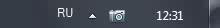
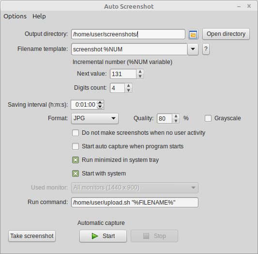

[:uk: EN](README.md "English")&nbsp;&nbsp;
[:fr: FR](README-fr.md "French")&nbsp;&nbsp;
[:ru: RU](README-ru.md "Russian")

-------------------------  

Auto Screenshot
===============

[](https://github.com/artem78/AutoScreenshot/releases/latest)
[](https://github.com/artem78/AutoScreenshot/blob/master/LICENSE.txt)


[](https://github.com/artem78/AutoScreenshot/releases/latest)
[](https://github.com/artem78/AutoScreenshot/releases/latest)

## Panoramica
**Auto Screenshot** — applicazione per l'acquisizione automatica di schermate con intervallo di tempo specificato.

## Funzionalità
* Salvataggio automatico schermate a schermo intero con intervallo di tempo specificato (da 1 secondo a 24 ore)
* Salvataggio immagini in formato PNG, JPEG, BMP, TIFF, WEBP o AVIF
* Opzione pausa acquisizione quando l'utente non è attivo (a seconda dei movimenti del mouse e degli eventi della tastiera)
* Nomi dei file output personalizzabili con variabili (data, ora, utente, nome computer, numero sequenziale) e possibilità di raggruppamento per cartelle (ad esempio: per giorno o mese)
* L'acquisizione automatica può essere eseguita all'avvio del sistema
* Supporto schermi multipli
* Supporto DPI elevati
* Può eseguire comandi personalizzati prima/dopo aver acquisito la schermata
* Cancellazione vecchie schermate
* Riproduce un suono quando viene catturata la schermata
* Tasti rapidi
* Funziona con Windows e Linux
* Assolutamente gratuito e open source

## Schermate







## Lingue
* [Inglese](README.md)
* [Russo](README-ru.md)
* Cinese
* Ucraino
* Poroghese
* Spagnolo
* Turco
* Tedesco
* [Francese](README-fr.md)
* Italiano

[(Aiutaci con la traduzione)](#Traduzione)

## Sistemi operativi supportati
* Microsoft Windows XP, 7, 8, 10, 11 (32/64-bit)
* Linux

## Download
Download programma [qui](https://github.com/artem78/AutoScreenshot/releases/).

### Windows
Puoi scegliere tra file zip versione portatile o programma di installazione.

### Linux
Per Linux sono disponibili la versione portatile e il pacchetto deb. Testato con Linux Mint e Ubuntu.

<!--
**Nota:** per abilitare le funzionalità di rete, come il controllo degli aggiornamenti, assicurati di aver installato le librerie SSL (incluso il pacchetto di sviluppo).
```
sudo apt-get install openssl libssl-dev
```
-->

## Compilazione dai sorgenti

Descritto in [/docs/build.md](/docs/build.md)

## Come posso aiutare?
* [Segnalando i problemi riscontrati](https://github.com/artem78/AutoScreenshot/issues/new?assignees=&labels=bug&template=bug_report.md&title=)
* [Suggerendo nuove idee o funzioni](https://github.com/artem78/AutoScreenshot/issues/new?assignees=&labels=enhancement&template=feature_request.md&title=)
* Aiutarci con la traduzione
* [Facendo una donazione](#donate)

## Traduzione

Puoi modificare la traduzione o crearne una nuova. Partecipa alla localizzazione su Transifex.com: <br/>[Transiflex - Traduzione Auto Screenshot](https://app.transifex.com/--334/autoscreenshot/dashboard/)

Puoi modificare i file lingua direttamente nel repository. Formato del file lingua e ulteriori dettagli sono descritti qui: <br/>[Istruzioni localizzazione Auto Screenshot su GitHub](https://github.com/artem78/AutoScreenshot/wiki/UI-localization)

## Licenza
Sei libero di usare, modificare o distribuire questo software sotto licenza [GNU GPL v3.0](https://github.com/artem78/AutoScreenshot/blob/master/LICENSE.txt).

## Author
Artem78 (email: [megabyte1024@ya.ru](mailto:megabyte1024@ya.ru?subject=AutoScreenshot))

## Dona
- ETH Ethereum / Tether USDT: 0xB14C877b2eAF7E3b4b49df25039122C0545edA74
- Webmoney WMZ: [Z598881055273](https://pay.web.money/d/kgfx)
- Sberbank card: 5469 4009 8490 5476
- ЮMoney (yoomoney): [4100 1195 0619 6001](https://yoomoney.ru/to/4100119506196001)

## Collegamenti
- [Sito web Auto Screenshot](https://artem78.github.io/AutoScreenshot/)
